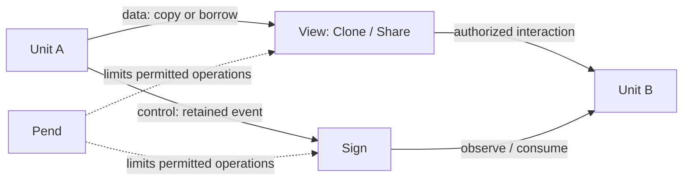

# Kernel architecture

Shuyra Kernel provides the mechanisms that let isolated execution domains
compose data flow and control flow without silently discarding their protection
boundaries.

A program can normally exchange data and coordinate execution within one
address space. Dividing it into independently protected Units interrupts those
relationships. The Kernel does not erase the boundaries; it supplies explicit
objects, authorities, transitions, and completion evidence for crossing them.

The architectural question for every cross-boundary operation is:

> What crosses the boundary, who may authorize it, which obligations survive
> the operation, and what evidence makes the operation complete?

This guide describes the enduring model. For the **current** representation,
operation names, constraints, and wire format, consult the source and
[Kernel API](../../api/README.md). A design principle here is not a promise
that every proposed behavior has been implemented.

## Two flows, one protection model

Data may be copied into independent storage or made accessible under a bounded
borrow. Control may be signaled, routed, scheduled, or awaited. Neither kind of
flow carries unrestricted authority over the other.

The diagram is a semantic map, **not** a syscall sequence or an assertion
that every internal operation requires a View.

The [core model](model.md) explains how Unit, Page, Cell, Flat, Nest, View,
Pend, Sign, and Room fit together, including their identities and lifetimes.

## Separation of concerns

| Boundary | Owned responsibility |
| --- | --- |
| [API](../../api/) | Public model, typed syscall ABI, and trusted boot contracts |
| [Client](../../client/) | Typed invocation and architecture-specific call transport |
| [Server basis](../../server/src/basis/) | Resource, authorization, execution, and retirement state |
| [Server entry](../../server/src/entry/) | Boot wiring, syscall/trap entry, dispatch, and reporting |
| [Server metal](../../server/src/metal/) | Selected architecture and platform mechanisms, including hardware ordering |
| [Vanllia](https://github.com/shuyra-arche/vanllia) | Product composition, provider selection, and system-level integration |

The Kernel enforces resource and access safety; it does not own PCI enumeration,
device business protocols, service discovery policy, swap replacement policy,
or language-runtime implementation. These belong to the relevant providers or
integration owner. It may implement the **hardware mechanism** required to make
an externally initiated memory access safe without becoming the device manager.

A Cluster organizes sources and builds. It is not a Kernel protection domain or
a runtime Unit.

## Documentation boundaries

- **Architecture** explains the model, enforcing owners, and safety invariants.
  It should survive routine refactoring.
- **Contracts** state observable behavior and exact encodings. The
  [API reference](../../api/README.md) and [API source](../../api/src/) are the
  entry points; a contract change requires an explicit compatibility review.
- **Implementation** is discoverable through module-level comments, code, and
  narrowly scoped tests. The [root README](../../README.md) records the current
  repository layout, build entry points, and implementation status.

Design history and unresolved alternatives belong in Issues and PRs, not in
parallel copies of a speculative public API. In particular, the public Port
boundary is under [review in #124](https://github.com/shuyra-arche/kernel/issues/124).
The enduring requirement is trusted external requester identity and safe
retirement, **not** a commitment to a public object named Port.

## Reading order

Start with [the core model](model.md), then trace a public contract in
[api/src/model](../../api/src/model/) and [api/src/abi/call](../../api/src/abi/call/).
Follow its implementation through [server/src/basis](../../server/src/basis/);
consult `entry` and `metal` where the operation crosses into a trap, CPU page
table, device translation, or trusted completion path.

For the original composition goal and the state-transition approach, see
[Kernel #14](https://github.com/shuyra-arche/kernel/issues/14).
