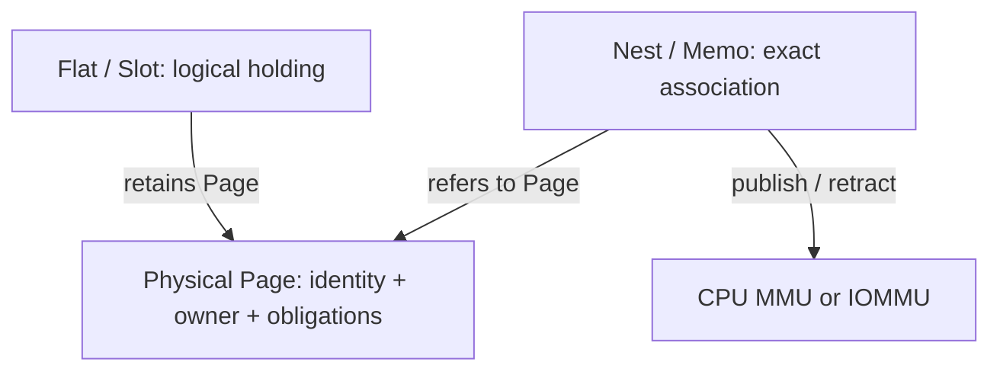

# Core model and safety invariants

This document describes the Kernel's conceptual objects and their enforcing
responsibilities. It distinguishes durable safety rules from the current public
spelling of operations. Exact ABI layouts, error codes, and version migration
belong in [Kernel API](../../api/README.md).

## 1. Isolation and execution

A **Unit** is the architectural subject whose execution, data access, and
lifetime are bounded by Kernel-controlled isolation. The current public
execution model exposes two kinds of target:

- **Team** is the protection and resource-sharing domain. It has an address
  space, membership, admission state, and responsibilities that outlive any one
  Task.
- **Task** is an execution instance belonging to a Team. It has scheduling
  state, context, waiting, and a retained result.

A Task's membership is not a grant to control its peers. Management authority,
data authority, and membership are separate relationships. Tasks within one Team
share an address space; a Task-local Pend by itself does **not** provide
hardware-enforced memory isolation from those peers.

[Unit calls](../../api/src/abi/call/unit.rs) manage execution and results.
[Room](../../server/src/basis/room/) coordinates placement, waits, deadlines,
interrupt delivery, and shutdown. A Sign may announce completion, but it does
not replace the authoritative Unit result or bestow control authority.

## 2. Physical ownership, logical holding, and address projection

These are different facts and must not become competing sources of truth.

| Concept | Responsibility | What it does not imply |
| --- | --- | --- |
| **Page** | One managed physical identity, owner, and outstanding access/reclamation obligations | A virtual address or a reusable page merely because a handle was dropped |
| **Flat / Slot** | Logical backing positions and their current physical holdings | Ownership of a second physical Page for each alias |
| **Nest / Memo** | Address positions, an association to an exact Page, publication state, and retirement records | Physical ownership merely because a Page can be mapped |
| **Cell** | Common position-based operations over a Flat Slot range or a Nest Memo range | That every Cell handle names a distinct physical allocation |

A Page has an owner, either Kernel or a Team. Other objects may retain it or
refer to it, but must not manufacture another owner of the same allocation.
Logical holding, address association, access rights, and physical reclamation
therefore have distinct lifetimes.

A Memo can retain an association to the **exact Page** even after the
originating Slot's current holding has changed. Slot identity is not Page
identity, and a fresh resident Page cannot silently satisfy an old mapping
generation.



### Geometry is not one universal page size

The public ABI indexes positions in **4 KiB base coordinates**. Managed
physical allocations use a checked `CellLevel`, with RISC-V level `L` size

```text
bytes(L) = 2^(12 + 9 * L)
```

The admissible levels depend on the selected Sv mode and actual physical
capacity. Translation backends separately choose legal hardware leaf sizes.
A logical coordinate, managed Page allocation, and CPU/IOMMU leaf must not be
treated as synonyms. See the [geometry contract](../../api/README.md#memory-geometry-three-distinct-units).

## 3. Data interaction, authority, and control events

| Concept | Boundary it represents | Governing rule |
| --- | --- | --- |
| **View / Clone** | Delivery of an independent copy | Copying data does not move the source Page's ownership |
| **View / Share** | Access to the same underlying data through a borrow | Access remains subject to the live Pend branch and its range |
| **Pend** | Authorization to call an operation on a specific target and, when applicable, borrow a range | A target ID or observation is not a credential |
| **Sign** | Retained, authorized source events, listener observation, routing, and consumption | Notification is not execution control or physical quiescence |

Pend separates target kind, permitted operations, mutability, distributability,
and effective range. `None` is an explicit permission category for
object-free creation calls, not ambient permission to operate on any resource.
Clone, Share, Flat, Nest, and Sign operations carry their own typed permission
sets. Control authority for Team/Task lifecycle is separate from data Pend
flags.

For shared data, multiple readers can coexist while a mutable borrow excludes
other borrowers. A parent lending mutable access is suspended until its child
returns and the required real accesses have been withdrawn. The current
conservative borrow model can suspend the whole parent even when the child
covers a narrower range; it does not promise independent disjoint writers.

A Clone Push produces an independent Kernel-owned payload. Clone Pull returns
an authorized, read-only payload handle with an exact length and sender. That
payload is accessed using a Share-style mapping of the **copy**, not by taking
a new borrow of the sender's original memory. Thus the two View modes remain
semantically distinct.

A Sign retains an event until it is consumed under its source and authority
rules. The event may be observed after its source has completed. Consumption,
driver acknowledgement, Task exit, and safe memory retirement are separate
events with separate evidence.

## 4. State, effects, and completion

A state transition should be understandable as a decision over an explicit
observation and event:

```text
transition(state, event) -> accepted(new_state, effects) | rejected(reason)
```

The protected commit boundary validates that the decision still applies and
publishes the state change. Hardware effects, notifications, and cleanup are
subsequent actions with their own completion or failure events. This describes
the **design discipline**, not a claim that every current implementation is
already a pure function.

For a Memo, the public observations distinguish `Vacant`, `Ready`, and
`Published` from `Publishing`, `Retracting`, and `Failed`. Association
does not itself publish a PTE. Request acceptance is not hardware completion.
A qualified generation prevents an old request or completion from acting on a
replacement association. A retracted mapping may retain a freeze that prevents
a conflicting writer until the owning record permits release.

A hardware-facing operation must separately account for:

1. **Admission:** no new conflicting use can begin.
2. **Withdrawal:** existing CPU or external address translation is removed or
   disabled through its owning backend.
3. **Settlement:** matching trusted invalidation, ordering, and completion
   evidence proves the relevant prior access can no longer occur.
4. **Reclamation:** only after every holder and hardware obligation is settled
   may physical capacity, tables, or hardware binding slots be reused.

The ordering is a safety requirement, not a fixed one-call public protocol.
A timeout, driver death, failed hardware command, or consumed Sign must not
skip settlement. Retiring or failed records retain an owner responsible for
retry, quarantine, or final cleanup.

In particular, **business completion is not safe-to-reclaim evidence**. This
applies to CPU TLB retirement and to external IOMMU/initiator access. A Page
cannot be returned to the allocator merely because its owning Task or a
mapping controller has exited.

## 5. Example: an external memory interaction

At the semantic level, an authorized driver-side interaction needs the
following sequence:

1. A trusted platform authenticates the external requester and associates
   its permitted translation domain with an authorized External Nest.
2. The caller reserves a Memo and associates the exact Page using the
   Cell position/transfer contract.
3. Publish begins hardware access with a qualified mapping generation.
4. The device performs its work; completion messages and Sign events may be
   delivered, but do not settle all hardware obligations.
5. Retract closes admission, withdraws translation, and waits for the
   backend's trusted settlement evidence. Other published Memos may still
   retain their own obligations.
6. A Page may be reclaimed or transferred only after **all** its relevant
   holders and access obligations are independently settled.

The currently implemented path also exposes Port identity and
`Nest.Attach`. [Issue #124](https://github.com/shuyra-arche/kernel/issues/124)
is reconsidering those **public** objects in favor of a narrower trusted
platform/Nest/Pend boundary. This document commits only to the safety
invariants; consult the actual [Nest](../../api/src/abi/call/nest.rs),
[Port](../../api/src/abi/call/port.rs), and
[Cell](../../api/src/abi/call/cell.rs) calls for the present implementation.

## 6. Review checklist

For a new operation or refactor, establish:

- **Identity and owner:** What is the authoritative object, and what prevents
  a stale reference from naming a replacement?
- **Authority:** Who may request, delegate, narrow, revoke, or observe it?
  Which permissions are independent?
- **Transition and commit:** Which states and events are legal, who enforces
  them, and what must be revalidated at commit?
- **Effects:** Which hardware or cross-Unit actions begin, and which
  components retain responsibility on partial failure?
- **Completion:** What exact evidence permits subsequent access, transfer, or
  reclamation? What remains pending after cancellation, exit, or timeout?
- **Verification:** Which test demonstrates the invariant at the smallest
  meaningful boundary? Does a Host test prove only Host behavior, or does the
  claim require QEMU or physical hardware evidence?

The code and public contract remain authoritative for current behavior. Open
design problems belong in Issues; this document should not silently turn a
proposal into a claimed implementation.
