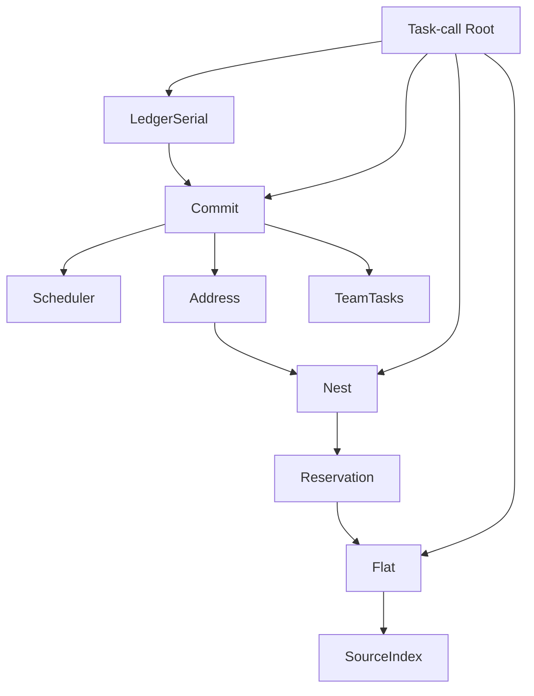

# Synchronization ownership and acquisition audit

This records M5 of [#185](https://github.com/shuyra-arche/kernel/issues/185).
The implementation is a generic physical `Lock<Order, Reentry, State>`, a
parent/target-borrowing `LockGuard`, one sealed acquisition relation, and
Debug-only acquisition diagnostics. The initial production typed route is
Task-call Root → actor LedgerSerial → the unique COMMIT → Flat inspection.
Other enforcing owners remain **explicitly staged legacy entries**, listed
below and in the field/call-site catalogue. This is not a claim of complete
compile-time coverage of the Kernel or cross-Hart wait-cycle detection.

The baseline is `852b396d20a1ae2954503a4dee9d970658c43558`; the shared engineering
standard is `.github@7967d812c6c9d40fde6a174483073b788af3e3cc`. M1–M4 and #184
remain independently reviewable work. Wire ABI 11 and resource permission,
Page ownership, publication and retirement authorities are unchanged.

## Evidence and navigation

- [Construction migration](constructions.md): all 96 baseline constructor
  sites, including every former `None` and `L3`, have a class or an explained
  replacement. A constructor is not an instance count.
- [Current fields](fields.md): concrete storage declarations and the displayed
  transitive reduction of the allowed graph, including separate ledger serial,
  entries, heirs, admission and charge classes.
- [Acquisition catalogue](acquisitions.json): current source function and line
  for each textual lock/try/pair/reentry/with entry. Regenerate both current
  catalogues with `python3 server/tests/sync/inventory.py`. Overloaded methods
  require their source context; this index does not prove transitive safety.
- [Production order](../../server/src/metal/riscv/sync/order/mod.rs): the **only
  rule source**. The explicit `relations!` closure generates both sealed
  `Before<Next>` implementations and the Debug matrix. No ordinal comparison,
  unknown class, blanket relation, ordinary self edge or default pass exists.
- [Tests](../../server/tests/sync/mod.rs): real production atomics, policies,
  typed guards, FIFO turns, predicates and bounded metadata over a host Hart/
  IRQ shell; separate compile tests exercise both debug-assertion settings.
  Namespace tests use host mutexes and do not prove RISC-V IRQ behavior.

The relationship table means permission to acquire while holding an ancestor;
it does not require acquiring every intermediate class. The diagram shows the
main resource route. The field table covers all remaining classes.

Actual code, allowed directions and remaining migration are distinct facts:
actual acquirers are the catalogue and owner paths below; allowed directions
are exactly `relations!`; the remaining migration is replacement of enumerated
legacy owner entries with borrowed typed contexts. A future owner change must
review its normal/error/Drop successors before adding an edge. Unobserved
combinations are not licensed by the former integer ranks.

## Physical lock and lifetime contracts

`Reject` selects the existing exclusive FIFO primitive and permits `DerefMut`.
`Accept` selects the existing same-Hart reentrant FIFO primitive and exposes
only shared `Deref`. Both retain actual atomic mutual exclusion, original
Acquire/Release ordering, saved IRQ state, contention reception and ticket
fairness. Policy dispatch is static; normal acquisition adds no allocation or
virtual call. Guards are neither Send nor Sync; sharing a Lock requires the
protected state to be Send. A marker never substitutes for the real guard.

A child borrows **both** `&mut` parent and the actual target for its lifetime.
`Accept::reenter` accepts no alternate target: its witness is that guard's
exact instance, and raw ownership must still match the executing Hart. A
same-class different instance is not reentry. Recursion shares one outer turn
and one Debug entry; only the last raw guard releases that turn. Dropping the
inner guard restores only its saved masked IRQ state.

`sync/global.rs` alone constructs `Lock<Commit, Accept, ()>`. `Constructible`
excludes Commit, raw constructors and guard factories are confined to sync,
and sealed policies/classes prohibit an external replacement implementation.
The `Policy::Raw` associated type does not expose a callable raw constructor.
`basis/commit.rs` remains the owner of transaction meaning; sync owns only the
single physical exclusion instance. No additional permission table exists.

The real Root factory is private to the RISC-V provider and requires the
private-field `switcher/trap::Boundary`. Only a **Task Call** trampoline entry
constructs that Boundary/Root. The captured event is passed forward once;
Kernel continuations, IRQ, page-fault servicing and boot create no Root. Root
is non-cloneable, non-defaultable and non-Send; dispatch passes or consumes it.
Flat inspection uses that Root, the actor's actual serial, `after_ledger`, and
the same Flat state lock. Authorization remains a live enforcing-owner check.
Other dispatch paths end the Root scope before parking, effects or scheduling.
Debug additionally rejects a Root with held ancestors. Rust cannot establish
uniqueness over arbitrary raw legacy call stacks; those are audited below.

## Controlled peers and the one reverse try algorithm

Flat's pair guard takes two immutable references to actual Locks, rejects
identical addresses in every build, acquires stable addresses in ascending
order, and returns the two distinct mutable states in **argument order**.
Borrowing prevents either lock moving while held. One RAII object owns both
raw guards; its field order releases the second before the first saved IRQ
state can be restored. A failed second try unwinds the first automatically.
No `Before<Flat> for Flat` or third peer exists. Flat's owner-confined legacy
pair bridge uses this same object; the old closure-only `with_pair` is removed.

Ledger pairing takes actual `Task` owners. The safe owner API derives immutable
TaskIds and the serial references together, rejects equal IDs on different
objects, sorts by non-reused TaskId, and takes the same Task only once. Both
attempts are nonblocking. A failed second try leaves no COMMIT turn or first
serial held. The raw mechanism requires unsafe owner proof; arbitrary caller
ID/Lock tuples and Root's generic Flat pair cannot safely instantiate it.
Its typed entry also borrows the Root, and its COMMIT child borrows the pair.

`nest/memo/source.rs::Source::borrow` has the **sole** reverse try exception:
while the real global COMMIT is held, a foreign source actor's serial is tried
once. Native publication can enter with COMMIT alone; the publisher's serial
is not assumed to exist. Debug requires exactly that actual COMMIT, at most
one existing publisher ledger and no resource-storage ancestor. It records
`SourceBorrow`; ordinary strict admission never permits Commit → LedgerSerial.
Failure returns Busy before any ticket is retained. Success may inspect the
source ledger/authority and register its existing owned admission records;
all subsequent ordinary acquisitions must be reachable from **both** COMMIT
and the acquired ledger. It may not take another ledger or a first-time COMMIT.
The source serial leaves before backend effects. There is no wait on that
serial while holding COMMIT, so the apparent inverse does not create a waiting
edge back to a publisher queued at COMMIT. This is the explicit try-only
algorithm permitted by issue §5.3, not a general reverse `Before` edge.

## Enforcing-owner acquisition audit

All rows below use the generic Lock storage. Unless stated otherwise the
staged entry is `LegacyLock<Class, T>`: its owning method establishes the
listed caller conditions, Debug checks every actual held instance, and its
software guard is local to a synchronous critical section. The complete field
list gives the exact per-class successors; allocator and last-reference Drop
successors are included rather than treating unnamed locks as leaves.

| Owner and actual acquiring paths | Held lifetime, following acquisition and failure obligations |
| --- | --- |
| `pend/ledger/table`, `admission`, `entry`; `pend/branch`, `ledger/cleanup` | Serial → COMMIT before authorization/publication. Entries, heirs, admission usage and charge are separate storage classes. Registration owns its reserved slot/charge and cancels on Drop; heir publication/cancellation owns its reservation. `Registration::commit` may enter CloneQueue while entries is held. Table close rejects new admission. Serial single/pair try failure is Busy with no retained turn. |
| `pend/authority` state and parent, `PreparedLimit` | PendState is now a storage leaf. `borrow_device` ends lender state before child parent registration; `finish` takes the parent return record out before touching lender state. Borrow counters/return records preserve the original custody. `PreparedLimit` stays within its local authority update; Unit adoption no longer retains it through spawn/Nest preparation. The same global COMMIT protects its precheck and final narrowing. |
| `pend/source` gate/flights/bindings/blocks/origins/phase, `hold`, `admission`, `provenance` | Gate → flight/binding/authority inspection, origins → provenance grant, stages → block pages are real nesting. `Withdrawal` is a borrowed gate guard, used only around synchronous admission/commit; it is not retained for withdrawal effects. `RangeBlock::vacate/reshape` may pass pages into Flat; tracking and recovery hold original source identities. Private→Root still uses the existing one-shot claim; no second lifecycle authority. |
| `flat` state, source export authorization/maps/authorities | Flat's real typed state has an owner-private `LegacyLock::from_lock` view for remaining methods; it is the same address/state/turn. Flat → SourceIndex and allocation/reclamation are allowed. Flat → Nest is forbidden. Same-class transfer uses the RAII pair. Source maps/authority indices remain discovery and retained cleanup responsibility, not an independent permission grant. `SharingOperation` is an existing owned atomic operation lease, not an IRQ guard. |
| `nest` layout, pending cleanup, state; span state/faults/exports | Address → Nest → Reservation → Flat. `enqueue_cleanup` must atomically decide closed-or-enqueue while Cleanup is held, so Cleanup → Nest is explicit; Nest → Cleanup is absent. `ready_state` returns the actual Nest guard and its caller must end it before hardware completion/waiting. FaultPolicy and SpanExports are separate from Reservation. PTE mutation and owned retirement admission are synchronous; unresolved hardware obligations remain in existing cleanup/publication records. |
| `nest/authority` ranges and organizations; `index/source`; Memo activity history and fault progress | Range bindings preserve original Pend/Span responsibility. Organizations/ranges may allocate and access source gates and Reservation/Flat through their enforcing methods. SourceIndex rebuild can free dead Box nodes; it has allocator successors. Source snapshots/weak upgrades are used outside index guards where later owner calls are required. Activity history and FaultProgress retain notification/generation records; waiter parking occurs after their guards. |
| `nest/activity` registry and delivery | Registry selects current observation identity and delivery; cleanup uses ledger pair then COMMIT before publication. Captured delivery/Task references outlive short registry storage scopes, not software locks. Unsupported/stopped observation paths cannot manufacture an admitted hardware proof. |
| `room/scheduler/slot`, ready/pending chains and admission | COMMIT → per-Hart Scheduler; queue selection, seating and departure may enter TaskState, TaskSchedule, TeamState, Registry and Deadline. Chain dequeue/Drop also updates TaskState. Steal tries a foreign slot and returns without retaining it on failure. Only owned Task/context addresses leave critical sections; no guard reaches the assembly context switch or idle wait. Reentrant COMMIT means the same actual instance, never Scheduler → first COMMIT. |
| `room/deadline`, `room/shutdown` | Deadline queue nests scheduling metadata/allocator as listed. Shutdown Progress is a short counter/time decision; stalled callback and non-returning Hart barrier run after it. Shutdown callbacks must independently obey their owner rules and never acquire a Root. |
| `room/interrupt` controller/progress/sources and per-source state | InterruptController is the device delivery mechanism, distinct from IOMMU Controllers. IRQ handling snapshots retained claims and uses try-COMMIT/deferred delivery; Busy keeps the event. Source/cancellation state is distinct from the shared source list. No IRQ/reception callback manufactures a typed root; existing ancestors remain visible to Debug. |
| `sign/endpoint`, `delivery`, `wait/holder`, `wait/site` | SignQueue → per-endpoint delivery; SignState sequences are short snapshots, routing takes owned route references before subsequent delivery. Wait shards and holders own enrollment/cancellation identities. Waking/parking and scheduler handoff do not retain shard/endpoint storage guards. Pending notifications and exact sequence consumption retain the existing semantics. |
| `unit/task` registry, state, receipts, results, request journal, heir, extensions and schedule | Registry weak lookup and member links use separate classes. Request journal only admits/records; no hardware callback executes under its guard. Completion uses existing owned result leases; late/dead Task callbacks cannot duplicate effects. Heir/TeamChildren capacity preparation ends before Nest attachment, then publication reacquires under unchanged COMMIT. TaskState/TaskSchedule/TeamState are not a generic UnitState bucket. |
| Task retirement and TaskMemory | `retirement::Progress` moves the original continuation out under a short try guard, leaves Active, then performs one stage without that guard. A competing/reentrant retire sees Busy. Drop stores the latest stage on every success/failure exit. TaskMemory is similarly taken into `MemoryRetirement`; None denotes its one in-progress owner, and partial success/Busy restores the exact original resources. Resident preparation copies immutable span geometry out before resolving faults. No phase/storage guard crosses a Nest completion. |
| Team state/tasks/children/held/termination/exit | TeamTasks may inspect member TaskState/receipts and Registry; TeamChildren may update the creator heir set, but those guards end before Nest attach. Team construction/retirement serialization is now an atomic RAII `Operation` lease, matching existing Span/source operation leases; it neither masks IRQs nor lends mutable data. State transitions still use COMMIT and the existing Team state owner. |
| Lifecycle termination/reap/husk queues and diagnostic ledger; CloneQueue | TerminationQueue → TeamState/TeamTermination, ReapQueue/Husks → TaskState through intrusive chain operations. Reaping extracts owned work before retirement. Diagnostic ledger snapshots remain short; it is not a resource authority. CloneQueue receives a prepared registration under Entries and may allocate; cancellation returns the existing original charge. |
| Boot MMIO stage, external regions and external Nests | BootMmio extracts/seals its staging vector before Flat/Nest installation. BootRegions/BootNests remain explicitly boot-only storage owners with their actual Nested resource/allocator successors; they never obtain Root. Single boot ownership is not an allocation-free leaf claim. |
| IOMMU Controllers | Boot installs the pool in a short scope, prepares Kernel Nest MMIO mappings/pages outside it, then installs/starts the retained engine under it. Runtime restoration is Nest → Controllers. Shutdown stops engines under the pool and reports closed/unsettled counts afterwards. Both success and error logging occur outside the pool: ordinary console translation can enter Kernel Nest. No Controllers → Nest edge was added. Failed/started engines and hardware pages remain in their original custody. |
| Allocator BlockPool/BlockPump/Tally/Frame/Spare/Bump; Asid | BlockPool prime/drain → Tally/Frame. `suck` detaches a pump list before entering pool, so there is no Pump → Pool edge. Frame/Spare statistics do not acquire domain owners; Bump is early-bootstrap only. Asid's first Recycle allocation may enter Frame; no fence occurs while the ID guard is live. Vec growth, Box/Arc creation and last-reference deallocation below resource guards use these same explicit classes. |
| Cell membership/change blocks/live-change registry/statistics | Per-Page membership, per-change Blocks and global statistics are separate classes. Hold/retire records carry real physical responsibility. Reclaim and last-reference Drop enter only listed page/allocator successors; they do not authorize earlier domain acquisitions. |

## Scope changes required by that audit

The former class cycles were **evidence of unsuitable class boundaries and
scope**, not a proof that the old COMMIT implementation already deadlocked:

- Pend state/parent no longer overlap in opposite directions (#198 prerequisite).
- TeamChildren/TaskHeir capacity guards end before Nest attachment; publication
  remains under the same global COMMIT.
- Boot IOMMU mapping is outside Controllers, and console output is outside it
  on initialization/error/shutdown paths.
- Unit adoption checks narrowing under COMMIT, spawns without PreparedLimit's
  state guard, then commits the same checked narrowing. Concurrent closure may
  only remove blockers; unsuccessful spawn leaves the authority unchanged.
- Pend accord holds its pair/COMMIT only for preparation, retains the existing
  unpublished registration/heir/operation records across exact register
  withdrawal, then reacquires and rechecks live Tasks, exact source Arc, permit,
  window, source gate and lending before publication. Failure cancels original
  reservations and does not publish a replacement record.
- Pend reduce releases serial/COMMIT for exact hardware withdrawal. After
  reacquiring both it checks the original Arc, live authority, newly published
  heirs and source blockers again **before** acquiring the source withdrawal
  gate and narrowing. A new heir causes Busy with unchanged limits. The host
  regression inserts that heir from the scripted hardware boundary and checks
  that serial is free.
- Private Nest creation and fresh-Team Nest preparation run outside serial/COMMIT, then recheck their live
  creation authority at the existing result publication boundary.
- Task/Team retirement and resident preparation retain owned resources and
  continuing responsibility, as detailed above, rather than storage guards.

These changes preserve original preparation/authorization/effect/retained
responsibility owners. Permission checks are not replaced by a typed guard.

## Debug tracking, Drop, boot and Release boundaries

`deadlock` is compiled only under `debug_assertions`. Per-Hart storage is
allocated before runtime admission and never grows on an acquisition path.
Each Hart has 64 initialized-prefix slots; the compile-time DAG longest-path
bound plus two controlled peers must fit. The ordinary check compares **every**
held instance to the proposed target. Pair and source-borrow predicates have
separate exact-instance conditions. `before` runs before FIFO reservation,
`acquired` only after success, `released` before the turn is released. Failed
try and precheck unwind retain no ticket/phantom entry and restore the caller's
original IRQ state. Overflow, unheld release and releasing a live pair's
predecessor diagnose explicitly. Reporting includes actual addresses, class,
acquisition PC and pair/exception kind; its bounded last-16 snapshot reports
how many earlier entries were omitted. Checking still examines all 64.

The relation matrix is static, rather than a large constant copied onto an
unoptimized trap stack. Held storage uses an initialized prefix of fixed
MaybeUninit slots; removal shifts Copy metadata and shortens that prefix. No
reference can address an uninitialized slot. IRQ-masked, owning-Hart access
is essential; reception in the existing wait path cannot concurrently borrow
this Hart's tracking cell. The host shell uses thread-local storage and the
same production predicates/metadata, not the production Hart pool or IRQ code.

Before pool initialization, early boot/allocator locks explicitly have no
runtime tracking. They use the existing physical locks, cannot create Root,
and are confined to boot. Per-Hart preallocation and missing-pool Root checks
are not silently disabled during runtime. OnceLock itself is the existing
one-time publication primitive, not an unclassified ordinary lock.

Implicit destructor families are ledger registration/charge/heir rollback,
Pend parent return, source withdrawal/flight/hold/provenance records, Flat
reservation cleanup, Page allocation/reclamation, Nest deferred disposal,
TaskMemory disposal, Task/Team receipt and intrusive queue removal. Their
metadata owners and allocator successors appear above. Reentrant callbacks,
Kernel IRQ and future destructor changes must retain those actual ancestors;
a new Root is not an escape hatch. Diagnostics use the emergency panic path,
not ordinary console translation under a failing lock.

Release has no held pool/stack, relation matrix, caller-PC capture, acquisition
checks or diagnostic panic. Generic type rules, actual exclusion/ticket state,
IRQ restoration, owner-identity pair rejection and state-lifetime checks remain.
The remaining raw staged APIs are explicitly enumerated; their Release caller
obligations remain source-audit obligations until further typed migration.

## COMMIT decision and validation limits

S5 retains the **one global COMMIT**. The cross-owner atomicity of branch
publication, authority closure, result admission and scheduler transfer has not
been proved equivalent under per-domain commits. The scope fixes above remove
hardware preparation/waiting from inappropriate software storage scopes; they
do not shard or replace global commit authority. No performance or WCET claim
is made. QEMU elapsed values only characterize that exact emulated composition.

Host checks cover real mutual exclusion, queued arrival/no-barging, recursive
ownership, precheck/failed-try unwind, exact peer identity, bounded storage,
retained retirement progress and real Rust lifetime/type rejection. RV64 builds
and pinned QEMU separately cover target behavior. Current SHA/toolchain,
composition pins and the commands/results belong to the implementing PR;
exploratory failed boots are not evidence for the final commit. Physical
hardware, complete wait-cycle detection and whole-Kernel static conversion are
outside this initial S4 migration. Future typed owner migration must use the
same real Lock and reviewed graph rather than adding a new permission owner.
